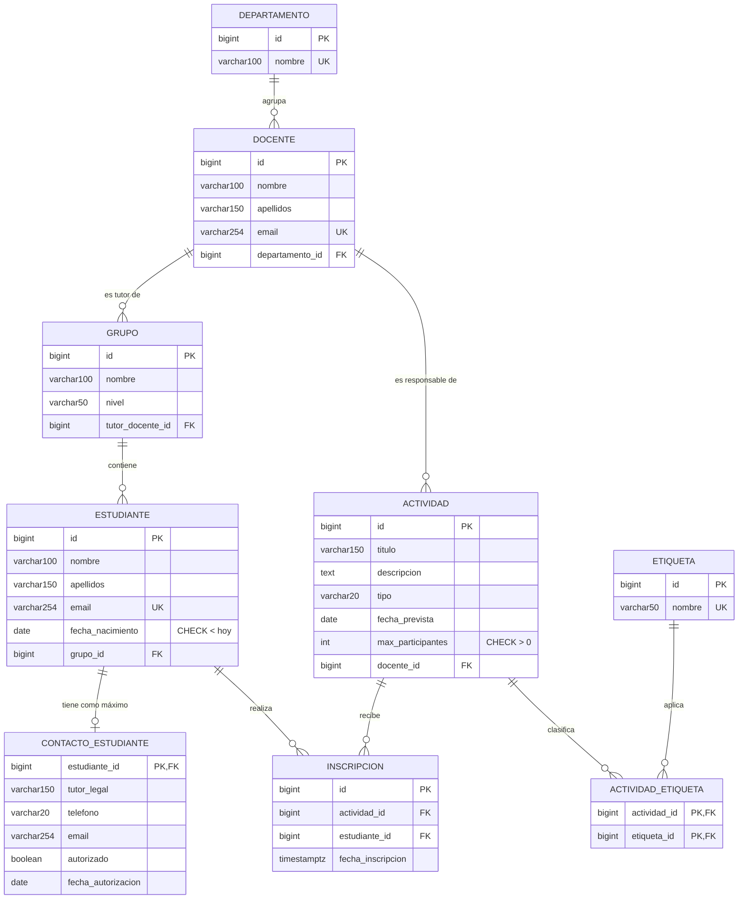

# Modelo de datos de CampusHub

Hemos repartido la información en dos motores. PostgreSQL guarda los datos relacionales y MongoDB guarda los seguimientos, cuya estructura cambia según el tipo de actividad.

## 1. Diagrama relacional (PostgreSQL)



## 2. Restricciones de PostgreSQL

| Regla | Mecanismo |
|---|---|
| Correo único de estudiante y docente | `UNIQUE` en `email` |
| Nombre único de departamento y etiqueta | `UNIQUE` en `nombre` |
| Una inscripción por estudiante y actividad | `UNIQUE (actividad_id, estudiante_id)` |
| Etiqueta repetida en una actividad | Clave primaria compuesta `(actividad_id, etiqueta_id)` |
| Capacidad mayor que cero | `CHECK (max_participantes > 0)` |
| Nacimiento anterior a hoy | `CHECK (fecha_nacimiento < current_date)` |
| Una sola ficha por estudiante | Clave primaria `estudiante_id`, que también es clave foránea |
| Campos obligatorios | `NOT NULL` en todas las columnas salvo `contacto.email` y `contacto.fecha_autorizacion` |
| Longitudes máximas | `varchar(n)` según la tabla anterior; `descripcion` usa `text` |

Hemos aplicado estas reglas con anotaciones de JPA (`@Table`, `@Column`, `@CheckConstraint`) y Hibernate genera el esquema con `ddl-auto: update`. Así el esquema vive junto a las entidades. En producción conviene versionarlo con Flyway o Liquibase.

### Borrado

- `ON DELETE RESTRICT` (por defecto) en todas las claves foráneas, salvo la ficha de contacto. Porque una inscripción o una actividad no deben desaparecer en silencio al borrar un docente o un estudiante.
- `ON DELETE CASCADE` en `contacto_estudiante`, porque la ficha no puede existir sin el estudiante.
- La API no ofrece operaciones de borrado.

### Índices

PostgreSQL no crea índices en las claves foráneas, así que los añadimos:

- `idx_docente_departamento`, `idx_grupo_tutor`, `idx_estudiante_grupo`.
- `idx_actividad_docente` e `idx_actividad_fecha`.
- `idx_inscripcion_estudiante` para el historial. La búsqueda por actividad ya usa el índice de la restricción única.
- `idx_actividad_etiqueta_etiqueta` para consultar las actividades de una etiqueta.

### Control de aforo

La inscripción bloquea la fila de la actividad con `SELECT ... FOR UPDATE` (`@Lock(PESSIMISTIC_WRITE)`). Dos peticiones simultáneas se ejecutan una detrás de otra, así que el recuento de plazas es siempre correcto. La restricción `UNIQUE` sigue protegiendo frente a duplicados aunque falle el bloqueo.

## 3. Modelo documental (MongoDB)

Colección `seguimientos`:

```json
{
  "_id": "ObjectId",
  "actividadId": 12,
  "tipo": "VISITA",
  "datos": { "empresa": "Acme", "observaciones": ["aprendizaje", "visita"] },
  "creadoEn": "2026-11-16T10:30:00.000Z"
}
```

- `datos` conserva la estructura recibida sin transformarla. Un tipo de seguimiento nuevo no exige cambiar el esquema.
- `actividadId` es solo el identificador de la actividad en PostgreSQL. No hay clave foránea entre motores.
- **Índice:** `idx_actividad_creado_en` sobre `(actividadId, creadoEn)`. Sirve para la consulta del detalle, que pide los seguimientos de una actividad por orden cronológico.
- **Validación `$jsonSchema`:** `actividadId`, `tipo`, `datos` y `creadoEn` son obligatorios. `actividadId` es `int` o `long`, `tipo` es texto de 1 a 50 caracteres, `datos` es un objeto y `creadoEn` es una fecha. No se restringe el contenido de `datos`.
- `MongoInicializador` crea la colección, el validador y el índice al arrancar. Si la colección ya existe, actualiza el validador con `collMod`.
